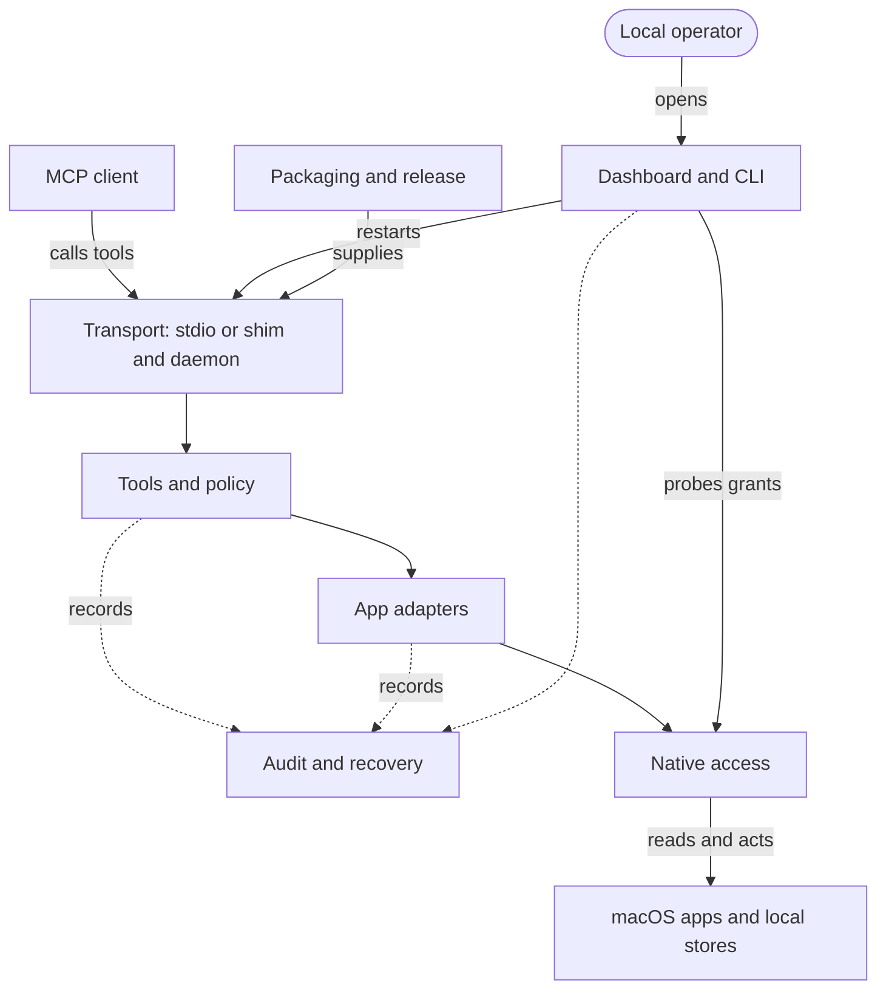

# macos-apps-mcp architecture

macos-apps-mcp gives MCP clients bounded access to ten native macOS app families.

Python adapters return citable pointers and perform explicitly requested actions.
FastMCP exposes the tools directly through standard input/output, or through a shim connected to a local daemon.
The daemon also provides a separate local operator dashboard.
The lock selects MCP 2.3.0, FastMCP 4.1.6, mcp-types 2.3.0, and httpx2 2.16.0.

**eli14:** The server is a workshop with a reception desk, specialist benches, and one shared machine station.
The desk accepts permitted jobs, and each bench knows its app.
The station handles native app access in order.
A job can finish even when its receipt is lost; the missing receipt does not make repetition safe.

## Components

The diagram describes implemented responsibilities. Arrows show communication or dependency, rather than permission grants.

The grid file [macos-apps-mcp-architecture.json](macos-apps-mcp-architecture.json) places these parts on the page and holds their links.

- [Transport](macos-apps-mcp-transport.md): client connections, protocol compatibility, and interrupted calls.
- [Tools and policy](macos-apps-mcp-tools-and-policy.md): typed boundaries, capability gates, and result notices.
- [Native access](macos-apps-mcp-native-access.md): serialized framework access, native readers, and process cleanup.
- [Adapters](macos-apps-mcp-adapters.md): app-specific reads, actions, and limits.
- [Audit and recovery](macos-apps-mcp-audit-and-recovery.md): audit records, Mail backups, and recovery receipts.
- [Operator controls](macos-apps-mcp-operator-controls.md): dashboard access, diagnostics, adapter settings, and restart.
- [Packaging and release](macos-apps-mcp-packaging-and-release.md): locked dependencies, universal bundle, notices, and release evidence.

## Rules

- A tool becomes visible to a client only after its capability gate passes. Tool registration applies the gates.
- EventKit, AppleScript and native database work runs one call at a time on one worker. Native databases open read-only.
- The transport warns about an interrupted call and never replays it.
- The audit log is best-effort: a native action can finish without a stored audit record. A Mail batch acts only after its plan record is written.
- A caller name or a shim identifier is an advisory label, not an authenticated identity.
- Mail recovery is not a general undo. Notes has no full-body backups.
- Private storage checks protect particular file writes. They do not stop every native action when storage fails.

## Lifecycle and acceptance

- `active` describes project lifecycle, not runtime health.
- Implementation, installed-device acceptance, and release are separate states. A checked roadmap box alone does not complete acceptance.

Migration #550, private storage #552, distribution notices #553 and localization #554 are implemented at the source revision above.
Mail refuses an ambiguous Trash (#556); its device acceptance is open. Non-English device acceptance and real-index timing are open.
Adapters permission chips use the last completed Health report under #497. Issue #497 stays open.
Notes write guards and full-body backups are planned in Phase 05.6.
The latest published release is `v0.15.1`, checked on 2026-11-09. GSD's `v0.11.0` milestone label is not the software version.

[Installed evidence](../overnight/2026-11-04-installed-acceptance.md) verifies signed arm64 build 7bc8607 and bounded native reads.
[Notarization and physical Intel installation](../overnight/2026-11-04-notarization-intel-acceptance.md) passed for the same build.
On build `3dd93b2` the read-only device suite passed, and a real frontend survived a daemon restart and an outage.
Phase 05.4 verification passed on 2026-11-06. Phase 05.2 device acceptance failed on build `926ec99`. The release stays open.

The project can be active while a part of it needs repair.
A finished part, a part tested in its installed position, and a delivered product have different completion records.

## Sources

`source_revision` identifies the checked code baseline, and `source_evidence_date` the date of that check.
The page commit comes from Git, not from this note. User review remains pending.
[Publication evidence](../overnight/garage-publication-2026-11-04.md) records the first publication on 2026-11-04, by the earlier plain HTML publisher.

- [Project scope](../PROJECT.md) and [phase roadmap](../ROADMAP.md).
- [Tool server](../../macos_apps_mcp/server.py), [transport](../../macos_apps_mcp/daemon.py), and [dependency lock](../../uv.lock).
- [Migration implementation and acceptance limits](../phases/05.4-mcp-2-fastmcp-4-migration/05.4-IMPLEMENTATION.md) and [Phase 05.4 UAT](../phases/05.4-mcp-2-fastmcp-4-migration/05.4-UAT.md).
- [Private storage implementation](../phases/05.6-bug-fixes-notes-write-safety-and-system-folders-in-any-langu/05.6-01-SUMMARY.md).
- [Distribution notice inventory](../../packaging/licenses/README.md).
- [Planned Notes safety](../phases/05.6-bug-fixes-notes-write-safety-and-system-folders-in-any-langu/05.6-CONTEXT.md).
- [Implemented grant chips and acceptance limits](../phases/05.6-bug-fixes-notes-write-safety-and-system-folders-in-any-langu/05.6-04-SUMMARY.md).
