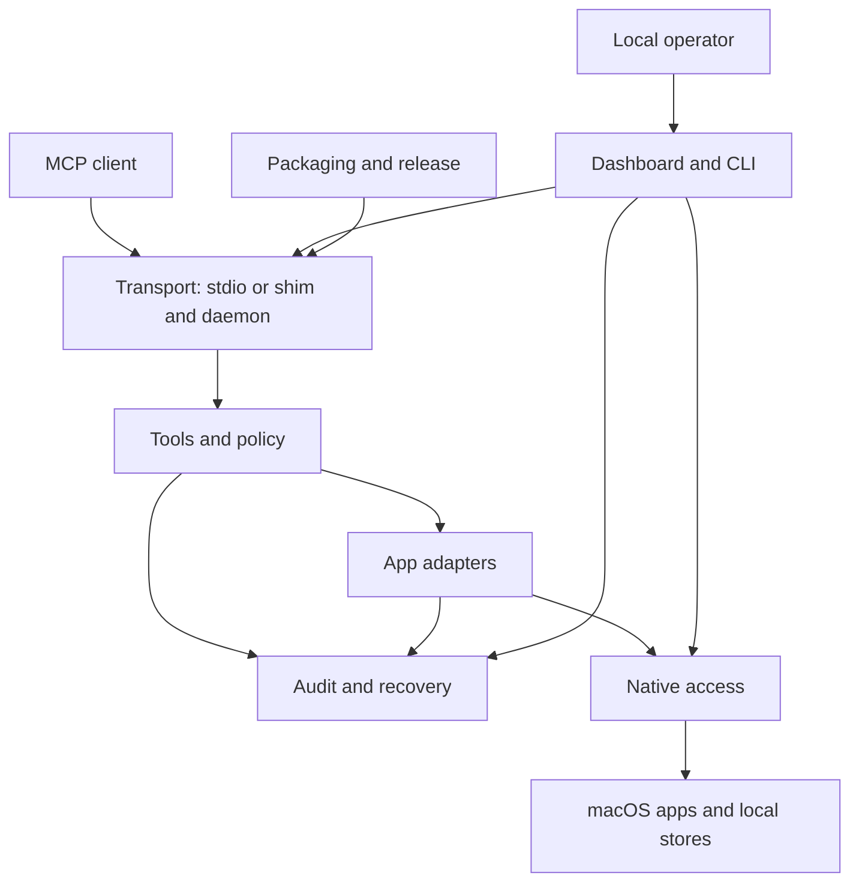

# macos-apps-mcp architecture

macos-apps-mcp gives MCP clients bounded access to ten native macOS app families.
Python adapters return citable pointers and perform explicitly requested actions.
FastMCP exposes the tools directly through standard input/output, or through a shim connected to a local daemon.
The daemon also provides a separate local operator dashboard.

**eli14:** The server is a workshop with a reception desk, specialist benches, and one shared machine station.
The desk accepts permitted jobs, and each bench knows its app.
The station handles native app access in order.
A job can finish even when its receipt is lost; the missing receipt does not make repetition safe.

## Components

The diagram describes implemented responsibilities. Arrows show communication or dependency, rather than permission grants.

- [Transport](macos-apps-mcp-transport.md): client connections, protocol compatibility, and interrupted calls.
- [Tools and policy](macos-apps-mcp-tools-and-policy.md): typed boundaries, capability gates, and result notices.
- [Native access](macos-apps-mcp-native-access.md): serialized framework access, native readers, and process cleanup.
- [Adapters](macos-apps-mcp-adapters.md): app-specific reads, actions, and limits.
- [Audit and recovery](macos-apps-mcp-audit-and-recovery.md): best-effort records, Mail backups, and recovery receipts.
- [Operator controls](macos-apps-mcp-operator-controls.md): dashboard access, diagnostics, adapter settings, and restart.
- [Packaging and release](macos-apps-mcp-packaging-and-release.md): locked dependencies, universal bundle, notices, and release evidence.

## Implemented boundaries

The lock selects MCP 2.3.0, FastMCP 4.1.6, mcp-types 2.3.0, and httpx2 2.16.0.
Tool registration applies capability gates before tools become visible to clients.
The native worker preserves EventKit thread affinity.
Native database access uses read-only connections; app-specific actions use frameworks, AppleScript, or the Shortcuts CLI.
Caller names and shim identifiers are advisory labels, not authenticated identities.

Audit logging is explicitly best-effort. A native action can finish without a persisted audit record.
Private storage checks protect particular file writes; they do not disable every native action when storage fails.
Mail recovery does not provide universal undo. Notes write guards and full-body backups remain planned.

## Lifecycle and acceptance

- `active` describes project lifecycle, not runtime health.
- Completion dates describe historical records, not future delivery promises.
- A phase requires its acceptance checks; implementation or a checked roadmap box alone does not complete acceptance.
- Implementation, installed-device acceptance, and release are separate states.

Migration #550, private storage #552, and distribution notices #553 are implemented in the source revision above.
Localization #554 remains open at `67cfb879407baac3ec12a39d4a0099f17cc1725c`; its behavior is outside this baseline.
Live grant chips under #497 remain planned.
The latest published release remains `v0.15.1`. GSD's `v0.11.0` milestone label is not the software version.

The migration evidence covers an unsigned universal bundle and both executable slices on an Apple-silicon host.
It does not establish signing, notarization, installation, physical Intel acceptance, or native application acceptance for this baseline.
The currently installed build is unverified here.

**eli14:** A workshop can be active while a machine needs repair.
A finished part, a machine tested in its installed position, and a delivered product have different completion records.

## Sources and phase links

The source evidence date records source inspection. User review remains pending; no `as_of` review date is asserted.
Publication remains pending and has no publication date.

- [Project scope](../PROJECT.md) and [phase roadmap](../ROADMAP.md).
- [Tool server](../../macos_apps_mcp/server.py), [transport](../../macos_apps_mcp/daemon.py), and [dependency lock](../../uv.lock).
- [Migration implementation and acceptance limits](../phases/05.4-mcp-2-fastmcp-4-migration/05.4-IMPLEMENTATION.md).
- [Private storage implementation](../phases/05.6-bug-fixes-notes-write-safety-and-system-folders-in-any-langu/05.6-01-SUMMARY.md).
- [Distribution notice inventory](../../packaging/licenses/README.md).
- [Planned Notes safety and grant chips](../phases/05.6-bug-fixes-notes-write-safety-and-system-folders-in-any-langu/05.6-CONTEXT.md).

## Display contract — planned

These Markdown files are the local sources. The frontmatter describes content; it does not imply an implemented publisher validator.
The planned overview path is `/macos-apps-mcp/architecture/`.
Component paths are `/macos-apps-mcp/architecture/<component>/`, using the seven linked filenames without `macos-apps-mcp-` or `.md`.
These paths are not claimed as published.

The parent publication uses the existing plain HTML publisher after merge and vault cutover.
The Mermaid block remains source text; the component list provides equivalent navigation without a renderer.
Display assets must remain local. Working notes are excluded from display content.
