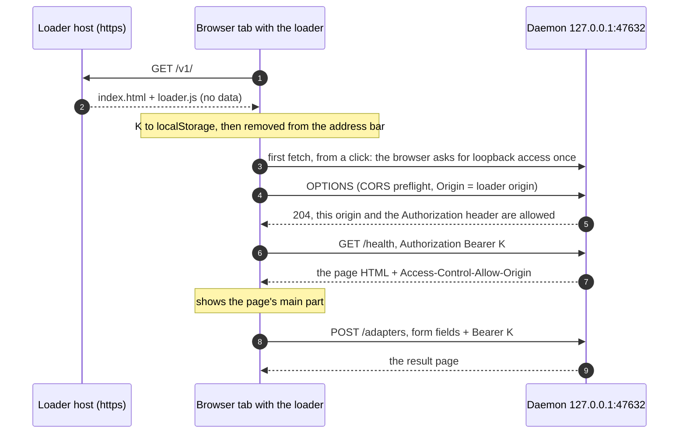

# Dashboard at a domain: the loader page — design

**Date:** 2026-10-25 · **Tracker:** #483 · **Status:** approved design, not yet planned ·
**Spikes:** 009–011 (`.planning/spikes/`)

## Why

The operator dashboard lives at `http://127.0.0.1:47632`. A domain such as
`https://mcp.lav.ren` is easier to find, to bookmark and to give to other installs. The model is
app.plex.tv: a page on a public origin that drives a server on the person's own machine.

app.plex.tv has three parts: a **shell** (an empty web page that every user downloads), **names
and certificates** (`*.plex.direct` gives each server its own https name), and a **relay** (the
fallback when the browser cannot reach the server). This design copies the shell only.

## Scope

- **Local only.** The browser runs on the Mac that runs the daemon. No relay, no LAN bind, no
  per-install certificates.
- **Read and write.** The loader carries every page, the adapter switches and the restart.
  Sending mail stays a Terminal command (`macos-apps-mcp allow-send`).
- **Self-host or use the published copy.** The loader is the same files for every user. Anyone
  can serve them on their own https origin. `127.0.0.1` is always the visitor's own Mac, so the
  published copy reaches each visitor's own daemon.

A browser cannot open the unix socket `mcp.sock`. The loader talks to the TCP socket
`127.0.0.1:47632`, which the daemon already serves. MCP stays on the unix socket.

## Data path

- The part after `#` never reaches the loader host, so the host never sees the key.
- The daemon keeps rendering every page. The loader only fetches, shows and submits, so a
  daemon release needs no new loader.
- Only the loader files cross the internet. Every page, with its data, goes from `127.0.0.1`
  to the browser on the same Mac.

## Browser support (spikes 009–011)

| Browser | Result |
|---|---|
| Chrome 156 | **Works.** One `loopback-network` prompt per site, from a click. "Allow while visiting the site" persists. 10 of 10 checks pass. |
| Firefox 158 (Zen) | **Works.** The same prompt and the same result. |
| Safari 27.0.1 | **Fails.** Every `fetch` to `http://127.0.0.1` or `http://localhost` from an https page is blocked before the network. Safari has no Local Network Access. A top-level navigation to `http://127.0.0.1` works. |

- The permission is `loopback-network`: the services on this Mac only. `local-network`, the
  LAN, is never asked for.
- CORS is plain CORS. No Local Network Access header reaches the daemon.
- `127.0.0.1` and `localhost` behave the same. `targetAddressSpace: "loopback"` is optional.

## Loader

Two static files under an immutable versioned path: `/v1/index.html` and `/v1/loader.js`.

- **Key.** Read `#key=…`, keep it in `localStorage`, then remove the fragment with
  `history.replaceState`. A key only in the fragment is lost in any new tab that opens the
  bare URL (spike 009, run 2). With no key, show the `macos-apps-mcp dashboard` command.
- **Permission.** Query `navigator.permissions.query({name: "loopback-network"})` and send the
  first request from a click. Do not query the legacy `local-network-access` name; it crashes
  older renderers. On `denied`, say how to allow it in the site settings, because the browser
  does not ask again.
- **Pages.** Fetch a daemon page with `Authorization: Bearer <key>`, parse it with
  `DOMParser`, and show its main part. Scripts in fetched HTML never run.
- **Links and forms.** Intercept the daemon's own links and form posts, and send them by
  `fetch` with the key. The form token in the page stays in the body.
- **Fallback.** When a loopback `fetch` fails before the network (Safari), show a link that
  navigates to `http://127.0.0.1:47632`. The link opens today's local page.
- **CSP.** `default-src 'none'; script-src 'self'; connect-src http://127.0.0.1:47632;
  base-uri 'none'; form-action 'none'; frame-ancestors 'none'`, plus the style and image
  sources the dashboard needs. No third-party script.
- **Hosting.** Public, on own infrastructure behind cloudflared (the homelab rule: a
  public-only service goes through cloudflared). It has no LAN-only gate, because the Mac can
  be away from home.

## Daemon changes

All in the request layer, `macos_apps_mcp/dashboard/guard.py`, plus the CLI:

- **Paired origins.** `macos-apps-mcp dashboard` gains an option that records a loader origin
  and opens `<origin>/v1/#key=<key>`. The daemon answers CORS only for a recorded origin.
- **Preflight.** An `OPTIONS` from a paired origin answers `204` with
  `Access-Control-Allow-Origin: <origin>`, `Access-Control-Allow-Methods: GET, POST`,
  `Access-Control-Allow-Headers: authorization, content-type` and `Vary: Origin`. Any other
  `OPTIONS` gets no CORS headers.
- **Responses.** Every response to a paired origin carries `Access-Control-Allow-Origin` and
  `Vary: Origin`, refusals included, so the loader can read a `401`.
- **Key.** `Authorization: Bearer <page key>` is accepted beside the cookie, with a
  constant-time compare.
- **POST.** A paired origin is an accepted `Origin`. The per-session form token and the 8 KiB
  body cap stay.
- **Unchanged.** The `Host` check (`127.0.0.1:<port>` or `localhost:<port>`, against DNS
  rebinding), the loopback-only bind, the security headers, the audit records with caller
  `dashboard`, and the Terminal-only outbound gate.

## Optional: a hash tripwire

The daemon release pins the SHA-256 of the loader files. The daemon fetches the paired
origin's `/v1/` files and compares. On a mismatch it stops answering that origin, and Health
says why. The `127.0.0.1` page keeps working.

- **Catches:** a defaced file, a wrong deploy, a break-in that does not target the check.
- **Misses:** a host that serves the good file to the daemon and a bad file to the browser.
  Browsers cannot pin a top-level page (Subresource Integrity covers scripts and styles only).
  It is a tripwire, not a lock.
- **Needs** immutable versioned paths, so a new loader does not break older daemons.
  Self-hosters serve the same bytes, so the same pin holds for them.

## Threat model

- **The loader origin joins the trusted base.** Code served from it runs with the page key and
  the loopback permission. It reads every page and can press the adapter switches and the
  restart. It cannot send mail. A compromise of the loader host, its deploy account or its DNS
  reaches the daemon through the browser and needs no LAN access.
- **The pages hold real data.** `audit._audit_args` keeps the first 200 characters of every
  string argument: mail recipients, subjects and the start of every sent body.
- **Users of a published copy trust its host** with that data and those switches. A self-hosted
  copy moves that trust to the self-hoster's host.
- **Other websites read nothing.** Without a CORS answer the browser hides every response
  (spike 009, unpaired mock; spike 011, live daemon). In Chrome and Firefox a site also needs
  the loopback permission before any request leaves.
- **Gains.** On the loader path the key travels in a header, so the cookie-to-every-port leak
  of `127.0.0.1` does not apply. A cross-site form cannot set the header, so CSRF fails.

## Not chosen

- **A redirect from the domain to `127.0.0.1:47632`.** No code, but the address bar ends on
  `127.0.0.1` and the cookie leak stays. It survives as the Safari fallback link.
- **Per-install certificates (the `*.plex.direct` pattern).** It would make Safari work, but it
  needs a DNS zone and a service that issues and renews a certificate for every install.
- **A relay, or cloudflared to a unix socket.** Dashboard data would leave the Mac.
- **A LAN bind behind the edge proxy.** It breaks the loopback-only rule and adds trust
  boundaries.
- **Rebuilding the dashboard as a JavaScript app.** The daemon already renders every page; the
  loader reuses them.

## Open decisions

- **Safari.** The fallback link above, or per-install certificates later.
- **Roadmap slot.** After Phase 05.2: open bugs go first.
- **Hash tripwire.** In the first version or later.
- **Styles.** Serve `/static/` without the key so the loader can link the daemon's stylesheet,
  or inject the fetched CSS.

## Verification for the build

- **Unit (`tests/`):** preflight for a paired and an unpaired origin, CORS headers on refusals,
  the Bearer key against the cookie, a paired `Origin` on POST, and the unchanged cookie path.
- **Device:** the spike 009 harness flow against the real daemon, with the loader on its real
  host, in Chrome and Firefox. In Safari: the fallback link opens the local page.
